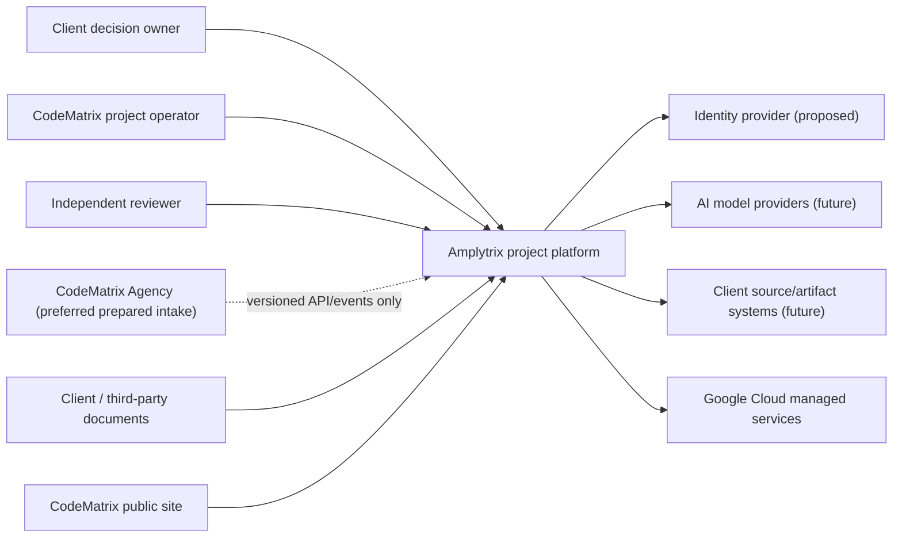

# C4 context

CodeMatrix Agency owns corporate/commercial management. Amplytrix owns project delivery data and
execution. No direct database, filesystem, or implicit identity trust crosses that boundary.
