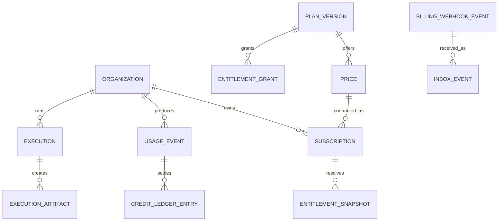

# Data growth and persistence inventory

| Schema            | Tables                                                                                                                                                                                                                                                                  |
| ----------------- | ----------------------------------------------------------------------------------------------------------------------------------------------------------------------------------------------------------------------------------------------------------------------- |
| identity          | users, user_identities, organizations, organization_members, organization_invitations, roles, permissions, role_permissions, member_roles, consents                                                                                                                     |
| catalog           | products, catalog_items, catalog_item_versions, features, plans, plan_versions, prices, plan_features, plan_item_access, plan_limits, add_ons, add_on_prices                                                                                                            |
| entitlements      | entitlement_definitions, entitlement_grants, entitlement_overrides, entitlement_snapshots, entitlement_audit                                                                                                                                                            |
| billing           | billing_customers, billing_provider_accounts, checkout_sessions, subscriptions, subscription_items, subscription_status_history, billing_cycles, invoices, invoice_items, payments, refunds, billing_webhook_events, billing_webhook_attempts, billing_idempotency_keys |
| trials            | trial_definitions, trials, trial_eligibility_checks, promotions, coupons, coupon_redemptions, founder_offers                                                                                                                                                            |
| usage             | usage_meter_definitions, usage_events, usage_reservations, usage_aggregates, quota_balances, credit_ledger, credit_packages, cost_records                                                                                                                               |
| ai_execution      | agent_definitions, agent_versions, skill_definitions, skill_versions, template_definitions, executions, execution_steps, execution_artifacts, execution_approvals, provider_usage, model_usage                                                                          |
| workspace         | workspaces, repositories, repository_integrations, workspace_members, workspace_settings, workspace_policies                                                                                                                                                            |
| technical_memory  | memory_sources, memory_documents, memory_chunks, memory_indexes, memory_versions, memory_access_policies                                                                                                                                                                |
| audit/integration | audit_events, outbox_events, inbox_events, idempotency_keys, integration_failures, dead_letter_events                                                                                                                                                                   |

UUID identities and UTC timestamps are immutable. Money is integer minor units plus ISO currency, never float. Published commercial versions/history are immutable; subscriptions point to a price version. Use FKs, unique/check constraints and query-evidenced indexes. Soft delete needs a retention/legal reason. Large binaries live in Cloud Storage with metadata/checksum in PostgreSQL. `pgvector` may support the first measured memory use case; external vector storage is evidence-triggered.

Partition usage/audit/execution events only after query/retention/load benchmarks show benefit. Growth path: tune/index/aggregate/retain/archive, then read replica/analytics separation, then extraction/sharding only with evidence.

