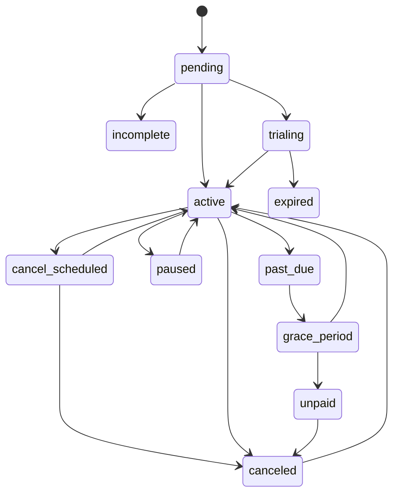

# Subscription architecture

The FastAPI modular monolith contains isolated commercial modules and one PostgreSQL database with schemas `identity`, `catalog`, `entitlements`, `billing`, `trials`, `usage`, `ai_execution`, `workspace`, `technical_memory`, `audit`, `notifications`, `experimentation`. SQLAlchemy mappings and Alembic migrations are infrastructure; local transactions own one context. Cross-context propagation uses published events, outbox/inbox and idempotent handlers.

Signup creates verified identity/consent, personal organization and local billing customer. Free creates an internal free subscription; trial first evaluates eligibility; paid creates a pending subscription and provider checkout. Only a verified/reconciled provider payment fact activates paid access. Every path recomputes an entitlement snapshot, audits and notifies.

Transitions are explicit commands or verified events with optimistic concurrency. Proration is previewed by the provider, disclosed and confirmed before mutation; provider capabilities that cannot meet this remain disabled.
