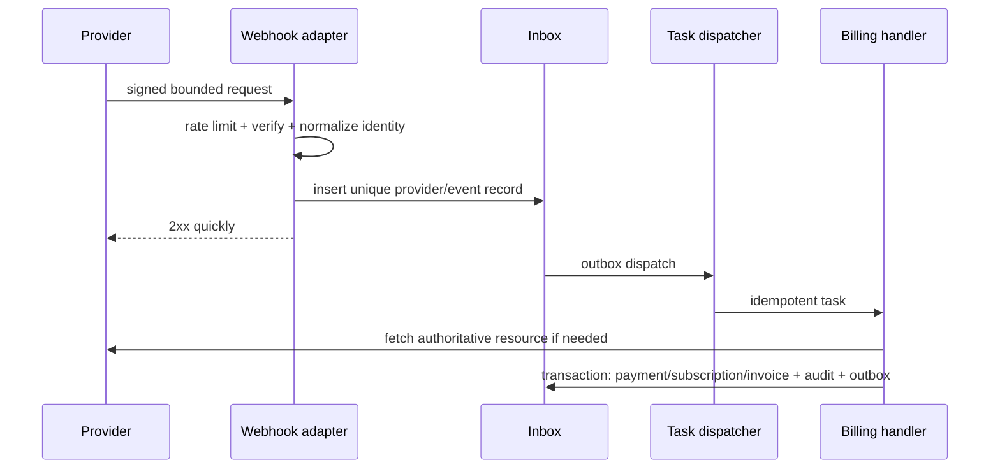

# Webhook processing

Reject invalid signature/size; do not log payload secrets. Duplicate events return success after lookup. Handlers tolerate out-of-order delivery through provider occurrence/version data and reconciliation. Transient failures retry with backoff; permanent failures enter a dead-letter record with reason, owner and controlled replay. Replay re-verifies authorization, preserves the original event, creates a new attempt and cannot bypass idempotency.
