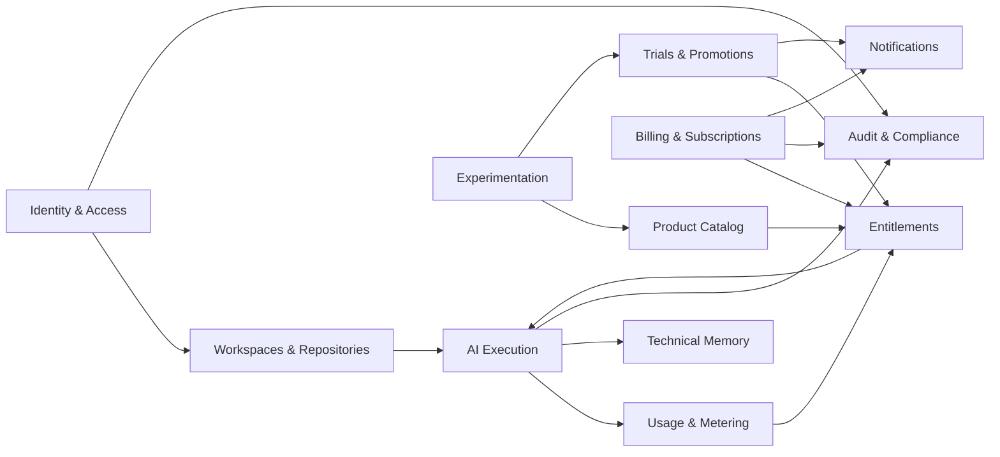

# Commercial context map

Arrows mean downstream consumption through an owned application contract, not table access. External identity, payment, model and source-control systems use Anti-Corruption Layers. In-process calls/events are default; durable outbox plus task/event delivery is introduced only where delivery semantics require it. Every consumer is idempotent.
