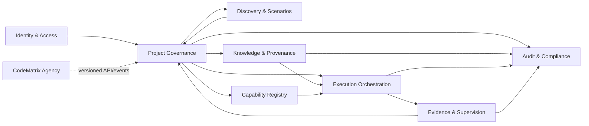

# Project-governed context map

Arrows mean downstream consumption through an owned application contract, never table access.
CodeMatrix Agency cannot read Amplytrix storage directly. External identity, model, source-control, and
future payment systems use Anti-Corruption Layers. In-process calls/events are default; durable
outbox plus task/event delivery is introduced only where delivery semantics require it. Every
external consumer is authenticated, authorized, correlated, and idempotent.
